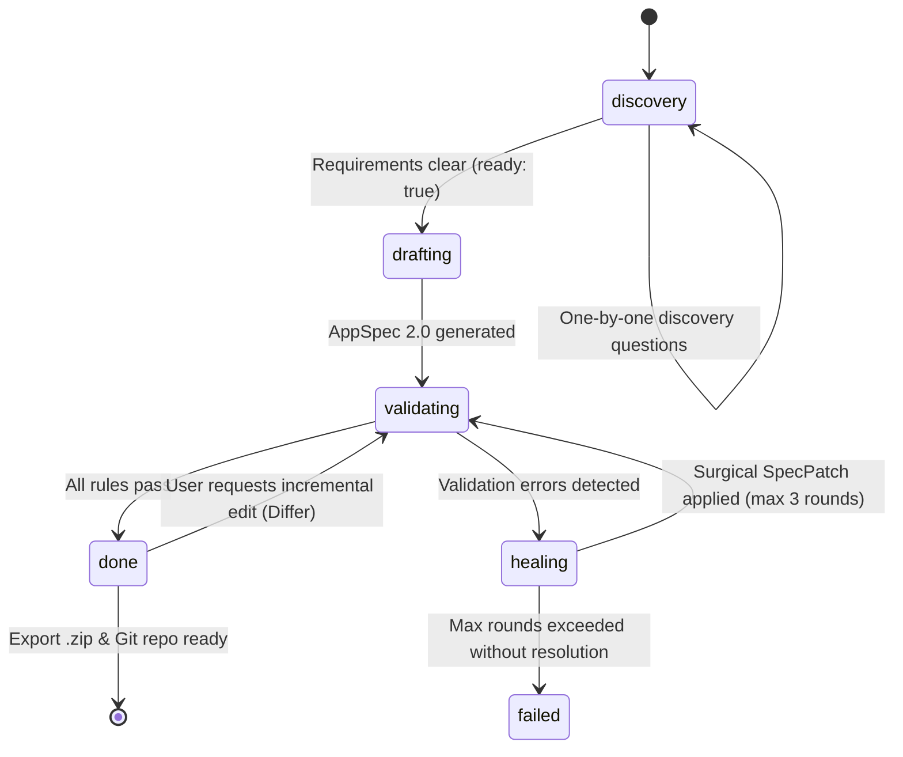

# Architecture & System Design — AI Frappe App Builder

## 1. High-Level System Architecture

AI Frappe App Builder is an autonomous, multi-agent implementer that takes natural-language business specifications and synthesizes installable, idiomatic Frappe/ERPNext applications.

```
                    +------------------------------------+
                    |  Three-Panel Workbench Frontend    |
                    |  (React 18 + TS + Tailwind v4)    |
                    +-----------------+------------------+
                                      │ REST & SSE Stream
                                      ▼
                    +------------------------------------+
                    |        FastAPI Orchestrator        |
                    |     State Machine Lifecycle        |
                    +-----------------+------------------+
                                      │ Dispatches tasks
          +---------------------------+---------------------------+
          │                           │                           │
          ▼                           ▼                           ▼
   [Interviewer]                [Architect]                   [Differ]
Discovery one-by-one         AppSpec 2.0 Synthesis      RFC 6902 JSON Patches
          │                           │                           │
          ▼                           ▼                           ▼
   [Validator]                   [Healer]                 [ScriptWriter]
Deterministic Rules          Surgical Spec Repairs    Controllers & Client Scripts
          │                           │                           │
          ▼                           ▼                           ▼
  [ReportBuilder]                [Exporter]                     [QA]
Workspaces & Reports      bench new-app canonical pkg    Bench & Unit Tests
                                      │
                                      ▼
                        +----------------------------+
                        |  Downloadable .zip bundle  |
                        |  Standalone Git Repository |
                        +----------------------------+
```

## 2. Orchestrator State Machine

The orchestrator (`ai_frappe_builder/agents/orchestrator.py`) runs an explicit typed state machine:


## 3. Communication & Streaming Protocol (SSE)

Real-time progress is streamed using Server-Sent Events (`GET /api/v1/sessions/:id/events`):
- `state_change`: State transitions (e.g. `discovery` -> `drafting`).
- `token`: Streaming conversational replies.
- `question`: Structured question with reason and choice pills.
- `spec_patch`: RFC 6902 patch operations applied to the spec.
- `validation`: Deterministic rule report with errors, warnings, and fix hints.
- `artifact_ready`: Downloadable .zip and file tree ready.

## 4. Single Source of Truth: AppSpec 2.0

All agents read from and mutate a single versioned contract: `AppSpecV2`.
- When an edit is requested (e.g., "Add GPS tracker ID to Vehicle"), the **Differ** agent emits a minimal RFC 6902 JSON Patch.
- The whole specification is **never** regenerated, eliminating hallucination drift and schema regression.

## 5. Storage & Persistence Layer

- **Async SQLAlchemy 2.0**: Default SQLite (`sqlite+aiosqlite:///./ai_frappe.db`) with pluggable PostgreSQL support.
- **SpecVersion**: Persists parent pointers (`parent_version_id`), RFC 6902 patches, and validation results.
- **LLMTracer**: Logs SHA-256 prompt hashes, token consumption, latency, and estimated dollar costs per LLM invocation.
